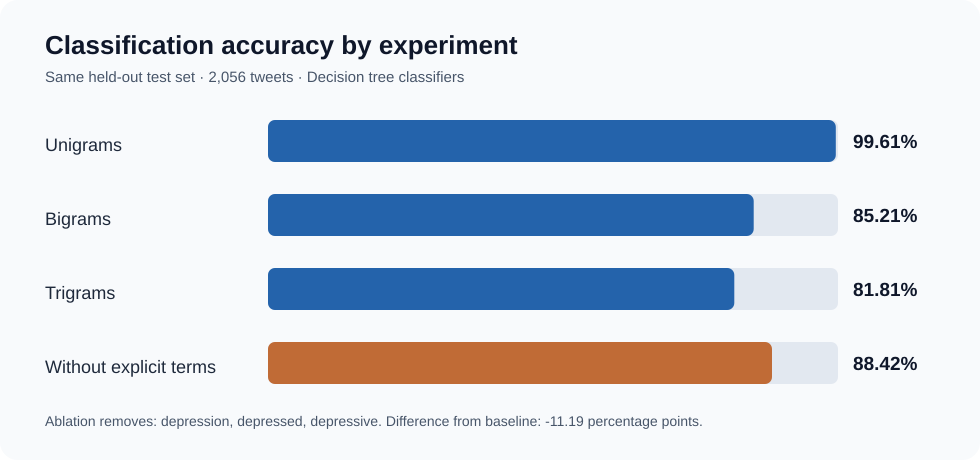
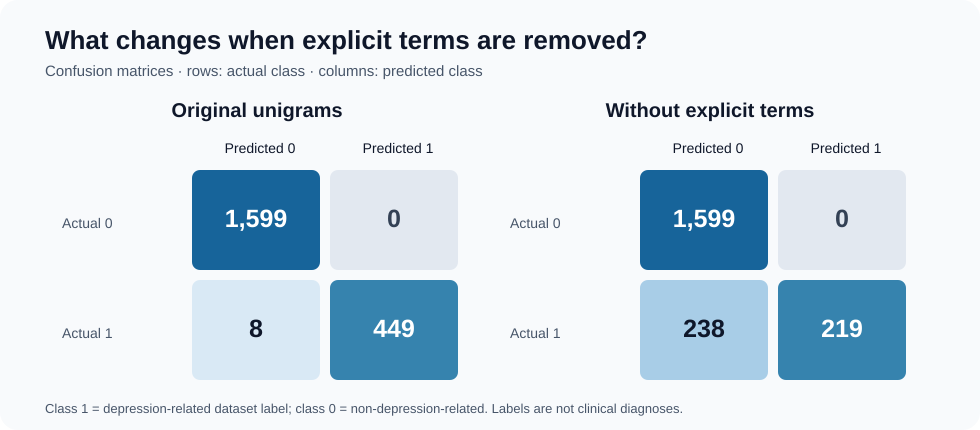

# Detecting Depression-Related Language in Tweets Using Machine Learning

**A decision-tree text classification project using unigrams, bigrams and trigrams.**

Can we use the words people write on Twitter to distinguish tweets labeled as depression-related from tweets labeled as non-depression-related? This project explores that question with an interpretable machine-learning approach: extract frequently occurring n-grams, represent each tweet using binary features, and train a decision tree to predict the dataset label.

**Important distinction:** the objective is to classify the *language in a tweet*, **not** to diagnose depression or determine the mental-health status of its author. We do not have clinically verified diagnoses for the people who wrote these posts.

[**Explore the notebook, with executed cells and decision-tree visualizations**](Sentiment_Analysis_Tw.ipynb)

## Results at a glance



All reported results below come from the corrected notebook, evaluated on the **same held-out set of 2,056 tweets**.

| Experiment | Accuracy | Balanced accuracy | Correct predictions |
| :-- | --: | --: | --: |
| Unigrams (1 word) | **99.61%** | **99.12%** | 2,048 / 2,056 |
| Bigrams (2 words) | 85.21% | 66.74% | 1,752 / 2,056 |
| Trigrams (3 words) | 81.81% | 59.08% | 1,682 / 2,056 |
| Unigrams without explicit depression terms | **88.42%** | **73.96%** | 1,818 / 2,056 |

The unigram model performs particularly well on this dataset. However, high accuracy must be interpreted carefully: common tokens can capture characteristics of the dataset's collection or labeling process, not necessarily broader patterns of depressive language.

## Dataset and evaluation

The included dataset, `sentiment_tweets3.csv`, contains text in the `message` column and binary labels in `label`: **0** for the non-depression-related class and **1** for the depression-related class.

We began with **10,314 tweets**: 8,000 in class 0 and 2,314 in class 1. Before creating training and testing partitions, we excluded exact duplicate messages and texts carrying contradictory labels. The resulting dataset contains **10,280 unique messages** (7,994 class 0; 2,286 class 1).

We then used a stratified **80/20 train/test split**, with a fixed random seed (`random_state=42`). The test partition has 1,599 class-0 tweets and 457 class-1 tweets.

Crucially, all feature selection is performed **using the training portion only**. The test portion is transformed using exactly the same selected n-grams, without consulting its labels.

## How the model works

The notebook follows the original coursework approach:

1. **Extract n-grams:** individual words (unigrams), pairs of consecutive words (bigrams), or sequences of three words (trigrams), using consistent preprocessing and English stop-word removal.
2. **Find common expressions:** in the *training set*, count n-grams separately for each class and retain the **five most frequent from each**. If both classes select the same n-gram, it is included only once.
3. **Build interpretable features:** represent each tweet with binary indicators showing whether its text contains each selected n-gram.
4. **Train a decision tree:** use `DecisionTreeClassifier(random_state=42)` and evaluate its predictions against the untouched test labels.
5. **Inspect the results:** compare accuracy, balanced accuracy, precision, recall, F1-score, confusion matrices and the actual decision-tree diagrams.

The notebook keeps the code comments and step-by-step presentation of the original university exercise, alongside corrections to the evaluation process.

## What if we remove the word “depression”?

One concern was that the unigram model might distinguish the classes mostly by recognizing explicit depression-related vocabulary. That vocabulary is not necessarily inappropriate: for tweet-level classification, a personal statement such as *“I have depression”* can be relevant evidence. Nevertheless, it is useful to measure how much the classifier relies on it.

We therefore performed an **ablation study**, removing the *whole-word* occurrences of `depression`, `depressed`, and `depressive` from **both the training and test text**. Then we selected the top unigram features again using the modified training set and trained a new decision tree with the same split.



| Unigram experiment | Accuracy | Class-1 recall |
| :-- | --: | --: |
| With explicit terms | 99.61% | 449 / 457 = **98.25%** |
| Without explicit terms | 88.42% | 219 / 457 = **47.92%** |

**The accuracy drops by 11.19 percentage points**, and the number of class-1 tweets correctly identified falls from **449 to 219**. At the same time, there are no class-0 false positives in either of these two confusion matrices.

This shows that the explicit words are **highly influential features for this dataset**. It does *not* establish that the original model is invalid, and it does not imply that the remaining 88.42% accuracy measures clinical depression detection. The lower class-1 recall highlights why accuracy alone can be misleading, especially with unequal class sizes.

## Interpreting the language features

In the corrected run, frequent class-1 unigram features included:

`depression`, `com`, `twitter`, `https`, `anxiety`.

After removing explicit terms, the selected class-1 features included:

`com`, `twitter`, `https`, `anxiety`, `emoji`.

Some are meaningful topic words, while others are fragments of URLs or platform-specific text. This raises an important methodological question: **is the classifier learning general depression-related language, or shortcuts associated with how the dataset was collected?**

This is an opportunity for further work rather than a reason to conceal the results. Useful extensions would include stripping URLs and platform markers, checking near-duplicate tweets, comparing alternative feature representations, and validating on independently annotated tweets from a different source.

## Limitations

- **No clinical ground truth.** Predictions refer to dataset labels, not diagnoses.
- **Dataset provenance and labeling.** We should not assume that an annotation method precisely measures symptoms, self-reported diagnoses, or author-level mental health.
- **Possible collection artifacts.** URL fragments and other metadata-like tokens may inflate apparent predictive performance.
- **Class imbalance.** Overall accuracy can hide low recall for the depression-related class; balanced accuracy and the full classification report provide important context.
- **Generalization remains untested.** Strong performance on this held-out split does not establish performance on different platforms, user populations, or annotation procedures.

## Run the project

**Requirements:** Python 3 and the packages `pandas`, `numpy`, `scikit-learn`, `matplotlib`, `notebook` and `ipykernel`.

Clone the repository and launch Jupyter:

```bash
git clone https://github.com/ClaudethClarissa/Depression_Sentiment_Analysis.git
cd Depression_Sentiment_Analysis
python -m pip install pandas numpy scikit-learn matplotlib notebook ipykernel
jupyter notebook Sentiment_Analysis_Tw.ipynb
```

The notebook is committed with its executed cell outputs and figures, so you can also **view the results directly on GitHub without running Python**. The [GitHub Actions workflow](.github/workflows/execute-notebook.yml) documents how the notebook was executed.

## Academic context and acknowledgement

This project was originally completed as an assignment for **Fundamentals of Network Analysis and Data Mining** at the **University of Calgary**, taught by **Professor Emma Towlson**. The repository preserves the original educational exploration and presentation style while incorporating corrections to the evaluation workflow and an additional ablation experiment.

---

*This project is an exploration of machine learning applied to textual data. It is not intended for screening, diagnosing, or making decisions about an individual's mental health.*
